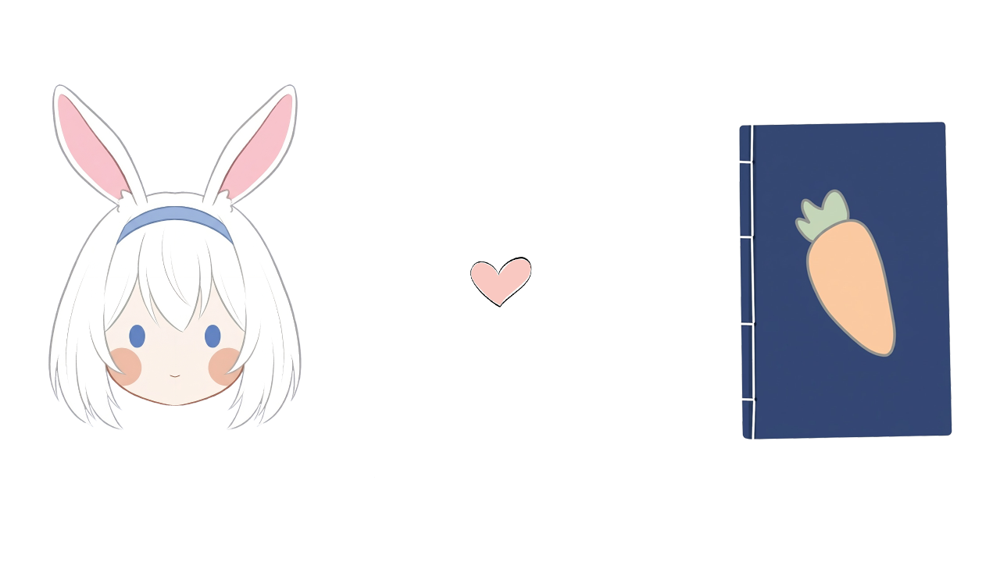

# **[Usagi](#)**

### Introduction

**Usagi** (*Japanese transliteration of "rabbit"*, うさぎ) **is just a free and open source manga reader app for Android 5.0+ devices.**

### Our works

With **[Usagi](#)**, we prioritize providing users with a convenient, fast, and smooth experience. Building on past successes, we continuously improve the user experience, offering more outstanding features while comprehensively optimizing for all devices. The community is highly creative, so we are constantly improving the project to give users more control and customization.

### License

All programs / libraries under our project are free, open-source programs under the GPL license. You may copy, distribute, and modify the software as long as you keep track of changes/dates in the source files. Any modifications to the software, including code licensed under the GPL (via a compiler), must also be provided under the GPL license.
